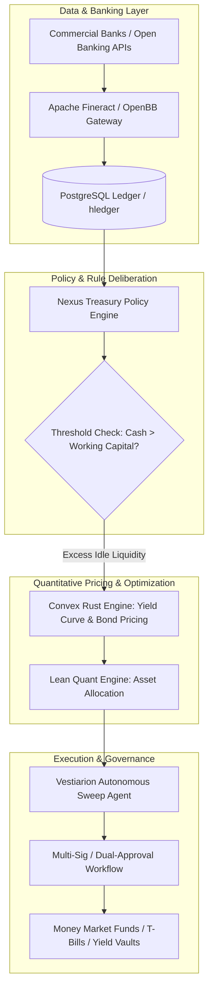

# Awesome Corporate Treasury Yield Optimization Tools & Software

> A curated directory of enterprise SaaS platforms, AI liquidity engines, and open-source GitHub software for **Corporate Treasury Yield Optimization**, **Cash Positioning**, **Idle Balance Sweeping**, and **Automated Working Capital Management**.

Last updated: March 2026.

---

## Table of Contents

- [Sector Overview & Market Dynamics](#sector-overview--market-dynamics)
- [Enterprise SaaS & Hosted Treasury Platforms](#enterprise-saas--hosted-treasury-platforms)
- [Open-Source GitHub Projects](#open-source-github-projects)
- [Architecture Blueprint for Custom In-House Engines](#architecture-blueprint-for-custom-in-house-engines)
- [How to Contribute](#how-to-contribute)
- [Disclaimer & Treasury Guardrails](#disclaimer--treasury-guardrails)

---

## Sector Overview & Market Dynamics

The global Corporate Treasury Management Software (TMS) and liquidity optimization market is estimated at **$6.6 billion to $8.0 billion in 2025–2026**, growing at a compound annual growth rate (CAGR) of **6.9% to 8.1%** (and up to **14%** for AI-augmented cash-forecasting and modern payment operations).

The sector is **moderately to highly fragmented** rather than a winner-take-all monopoly:
- **Legacy Conglomerates & Mega-Vendors:** Institutional incumbents like **FIS**, **ION Group**, and **Coupa** dominate complex multi-entity tier-1 global banks and Fortune 100 enterprise environments.
- **Mid-Market & Specialized Cloud Innovators:** High-growth challengers like **Kyriba**, **GTreasury (Ripple)**, **Modern Treasury**, **TIS**, and **Agicap** capture substantial market share by specializing in modern API-driven bank connectivity, real-time ISO 20022 compliance, programmatic sweeping, and autonomous liquidity planning.

---

## Enterprise SaaS & Hosted Treasury Platforms

Enterprise treasury management systems (TMS) enable finance executives, treasurers, and corporate controllers to connect multi-bank accounts, forecast cash runway, maintain policy guardrails, and automatically sweep idle operational balances into yield-bearing vehicles (e.g., overnight repo, money market funds, Treasury bills, or commercial paper).

The table below is sorted by **Company Size / Valuation / Enterprise Scale (Descending)**:

| Platform | Company Size (Revenue / Valuation) | Pricing (Specific Starting Tiers) | Free Tier / Free Trial Limits | Key Treasury & Yield Capabilities |
| :--- | :--- | :--- | :--- | :--- |
| **[FIS (Quantum)](https://www.fisglobal.com/)** | **~$18.5B Market Cap** (~$14.0B ARR) | Starting at **$120,000/year** (core cloud tier) + custom deployment ($75k+) | **No free tier; 30-day proof-of-concept (PoC)** available under enterprise sales engagement only (requires scoped test dataset and NDA). | Financial-institution grade TMS with multi-asset liquidity sweeping, debt & investment portfolio accounting, FX hedging, and automated cash concentration. |
| **[ION Treasury](https://www.iongroup.com/)** | **~$10.0B+ Enterprise Value** (~$2.0B+ Revenue) | Starting at **$90,000/year** for mid-tier hosted modules + integration services | **No free tier; 30-day sandboxed staging PoC** for qualified institutional clients (limited to 5 user seats and pre-loaded test ledgers). | Comprehensive treasury ecosystem (Wallstreet Suite, Reval, IT2) offering enterprise cash positioning, yield analytics, and multi-rail bank gateways. |
| **[Coupa Treasury](https://www.coupa.com/)** | **$8.0B Valuation** (~$818M+ ARR at buyout) | Starting at **$45,000/year** (Treasury & Cash Visibility module add-on) | **No free tier; 14-day guided sandbox access** provided post-sales demo with synthetic transaction data (limited to 3 test bank accounts). | Integrates treasury operations with unified Business Spend Management (BSM), PO cash matching, and working capital yield optimization. |
| **[Kyriba](https://www.kyriba.com/)** | **$3.0B+ Valuation** (~$120M+ ARR) | Starting at **$75,000/year** (mid-market 10–50 entities; up to $200k/yr) | **No free tier; 14-day dedicated pilot environment** for enterprise RFPs (capped at 2 connected ERP test instances and 10 entity profiles). | Global liquidity planning, SWIFT/bank connectivity across 1,000+ networks, automated cash sweeping, and AI-powered fraud & anomaly detection. |
| **[Modern Treasury](https://www.moderntreasury.com/)** | **$2.0B–$2.2B Valuation** (~$183M raised) | Starting at **$2,000/month** ($24,000/yr minimum platform commitment + usage fees) | **No free tier; 14-day developer sandbox trial** with unlimited simulated API calls and synthetic bank rails (live banking requires contract). | Programmatic payments operations via developer APIs; automated ledgers, instant wire/ACH/RTP/FedNow rails, and rule-based idle balance routing. |
| **[GTreasury](https://www.gtreasury.com/)** | **$1.0B Acquisition Valuation** (Ripple) | Starting at **$60,000/year** (typically 10–15% lower entry point than Kyriba) | **No free tier; 30-day guided evaluation pilot** for qualified finance teams (restricted to mock cash balance uploads and up to 3 bank feeds). | Driver-based long-range forecasting, GL treasury posting, multi-currency yield management, and blockchain-integrated corporate settlement rails. |
| **[Agicap](https://agicap.com/)** | **~$500M–$805M Valuation** (~$171M raised) | Starting at **€150/month (~$165/mo)** for SMB Starter plan; scales with bank accounts | **14-day full-feature free trial** with live bank synchronization (limited to 2 connected financial institutions and 1 user seat). | Real-time multi-bank cash positioning, automated cash flow forecasting, receivables acceleration, and idle balance surplus alerts. |
| **[TIS (Treasury Intelligence Solutions)](https://www.tis.com/)** | **~$350M–$500M Est. Valuation** (~$48M ARR) | Starting at **$35,000/year** for Core Cash Flow & Payment Factory tier | **No free tier; 30-day proof-of-value sandbox** for corporate enterprise evaluations (limited to 5 connected test bank BIC codes). | Multi-bank connectivity across 11,000+ global banking institutions, payment compliance, automated reconciliation, and surplus cash reporting. |
| **[Hazeltree](https://www.hazeltree.com/)** | **~$150M–$250M Est. Valuation** (~$22M ARR) | Starting at **$30,000/year** for Hedge Fund & Private Wealth Cash Manager edition | **No free tier; 30-day custom deployment evaluation** for hedge funds and asset managers (limited to 3 prime broker counterparty connections). | Specialized treasury, collateral management, counterparty risk analysis, and cash yield optimization for alternative asset managers and private equity. |
| **[Atlar](https://www.atlar.com/)** | **~$30M–$50M Early-Stage Valuation** (~$13.5M raised) | Starting at **€800/month (~$880/mo)** for Core API & automated treasury package | **14-day developer sandbox access** with simulated European/US banking APIs (live production account requires paid onboarding). | Cloud-native bank API platform with real-time liquidity visibility, J.P. Morgan integration, rule-based automated transfers, and AI treasury agents. |

---

## Open-Source GitHub Projects

For quantitative finance developers, treasury systems architects, and engineering teams seeking transparent, vendor-independent, self-hosted alternatives to monolithic TMS platforms.

The open-source projects below are sorted by **GitHub Stars (Descending)**:

1. **[OpenBB Terminal](https://github.com/OpenBB-finance/OpenBBTerminal)**   
   Open-source data platform and investment research terminal for quants and treasurers. Aggregates multi-asset macro data, yields, fixed income analytics, and currency rates with Python and AI-agent integrations.

2. **[ERPNext](https://github.com/frappe/erpnext)**   
   Comprehensive enterprise resource planning (ERP) platform featuring double-entry accounting, multi-currency treasury bank accounts, cash reconciliation, and automated liquidity management.

3. **[Actual Budget](https://github.com/actualbudget/actual)**   
   Local-first, privacy-focused double-entry cash flow and ledger application with multi-bank synchronization, customizable budget categorizations, and encrypted local storage.

4. **[Firefly III](https://github.com/firefly-iii/firefly-iii)**   
   Self-hosted financial manager supporting multi-account cash positioning, deterministic rule-based transaction automations, balance notifications, and budget analytics.

5. **[Lean by QuantConnect](https://github.com/QuantConnect/Lean)**   
   Institutional-grade algorithmic trading and automated execution engine (C#, Python) ideal for executing automated cash-sweep allocations, T-bill rebalancing, and fixed income strategy simulations.

6. **[Invoice Ninja](https://github.com/invoiceninja/invoiceninja)**   
   Self-hosted invoice, payments, and receivables optimization platform. Accelerates cash conversion cycles, manages multiple commercial bank accounts, and automates payment reconciliation.

7. **[Ledger CLI](https://github.com/ledger/ledger)**   
   The canonical command-line double-entry accounting engine. Provides deterministic balance tracking, mathematical auditability, and multi-currency valuation without database overhead.

8. **[hledger](https://github.com/simonmichael/hledger)**   
   Fast, robust plain-text accounting tool with CLI, TUI, and web interfaces. Ideal for scripted corporate treasury balance reconciliation, deterministic sweep tracking, and ledger audits.

9. **[GnuCash](https://github.com/gnucash/gnucash)**   
   Open-source double-entry accounting system tracking multi-bank liquidity, investment holding performance, cash flow projections, and reconciliation schedules.

10. **[Portfolio Performance](https://github.com/portfolio-performance/portfolio)**   
    Open-source portfolio accounting software evaluating yield, IRR, and benchmark-relative returns across money market instruments, government paper, and debt securities.

11. **[Rotki](https://github.com/rotki/rotki)**   
    Privacy-first portfolio tracking, analytics, and accounting suite that stores all balance information locally and securely integrates off-chain accounts and crypto assets.

12. **[Apache Fineract](https://github.com/apache/fineract)**   
    Enterprise core banking and financial services software platform. Manages liquidity pools, inter-account settlement transactions, interest accrual, and multi-tier deposit architectures.

13. **[FINOS Legend](https://github.com/finos/legend)**   
    Financial open-source data modeling and governance platform developed under the Linux Foundation. Standardizes financial data pipelines, liquidity reporting models, and compliance checks.

14. **[Picsou Finance](https://github.com/Cloeille/picsou-finance)**   
    Self-hosted personal and small business finance dashboard tracking multi-bank cash balances, investment accounts, and corporate liquid net worth in real time.

15. **[Flowy](https://github.com/Xen0Xys/Flowy)**   
    Self-hosted finance platform (Docker Compose, PostgreSQL) built for multi-account cash monitoring, role-based shared permissions, and custom liquidity category tracking.

16. **[Convex](https://github.com/sujitn/convex)**   
    High-performance fixed income analytics engine written in Rust. Executes yield curve bootstrapping, sub-microsecond bond pricing, YTM calculation, Z-spread, and includes an MCP server for AI treasury agents.

17. **[shared-finances](https://github.com/ynixt/shared-finances)**   
    Spring Boot and Angular accounting control system managing multi-account cash allocations, role-based authorization hierarchies, and grouped account balances.

18. **[Puzzle](https://github.com/BaDaaS/puzzle)**   
    Self-hosted asset tracking platform engineered for commercial operators and sole traders holding mixed balance sheets across cash, stocks, and short-term T-bills.

19. **[Vestiarion](https://github.com/duongnq2798/vestiarion)**   
    Autonomous treasury agent for modern businesses (settled in USDC on Arc). Screens counterparties, processes payables under deterministic rules, and executes autonomous sweeps into yield vaults.

20. **[Nexus Treasury](https://github.com/azaharizaman/nexus-treasury)**   
    Modular PHP treasury engine providing cash concentration pools, working capital policy rules, configurable user approval limits, and multi-currency authorization workflows.

21. **[Vantage-Point](https://github.com/rasali535/vantage_point)**   
    Multi-agent treasury risk architecture featuring mathematical anti-whipsaw filter layers (Kaufman Efficiency Ratio, ATR) and an AI Boardroom Council for automated policy compliance.

---

## Architecture Blueprint for Custom In-House Engines

Engineering teams can assemble an enterprise-grade, fully auditable, self-hosted treasury yield engine by composing specialized open-source building blocks:

---

## How to Contribute

We welcome additions from treasurers, fintech founders, and open-source contributors!

1. **Fork the repository** on GitHub.
2. Add your tool to the corresponding section:
   - For **SaaS platforms**, ensure the entry is placed in the table with verified starting tier pricing, free trial limits, company valuation/revenue, and maintain descending size sorting.
   - For **Open-Source projects**, add a social white star badge linking to `/stargazers` and position it according to its star count.
3. Keep descriptions factual, objective, and neutral.
4. Submit a **Pull Request** detailing why the tool qualifies as a corporate treasury or yield optimization solution.

---

## Disclaimer & Treasury Guardrails

- This repository is a **community-curated index** provided for informational and architectural research purposes. It does not constitute legal, tax, or financial investment advice.
- **Enterprise TMS Pricing Transparency:** Commercial TMS suites operate quote-based enterprise models ranging from **$30,000 to over $1,000,000+/year** plus professional implementation fees.
- **Strict Policy Guardrails:** Idle balance sweeping, automated investment rebalancing, and programmatic disbursements require strict dual-authorization controls, anti-whipsaw filters, counterparty credit ratings checks, and regulatory compliance. Never deploy unconstrained autonomous agents to live operating bank accounts.
